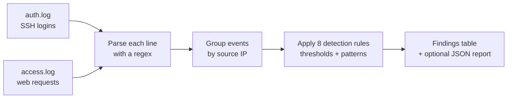

# log-threat-analyzer


A small Python tool that reads Linux SSH logs (`auth.log`) and web server access logs,
finds signs of attack, and labels each finding with its MITRE ATT&CK technique ID.
It is a mini version of what a SIEM detection rule does. No dependencies: Python 3.8+ standard library only.

## How it works



1. **Parse** – each log line is matched against a regular expression that pulls out the time, source IP, username or URL.
2. **Group** – events are collected per source IP.
3. **Detect** – rules look for either a *burst* (too many events in a short time window) or a *pattern* (attack strings in a URL).
4. **Report** – each finding gets a severity and a MITRE ATT&CK ID.

## Detection rules

| Rule | Fires when | MITRE ATT&CK | Severity |
|---|---|---|---|
| SSH brute force | 5+ failed logins from one IP within 5 minutes | T1110.001 Password Guessing | high |
| Successful login after brute force | the brute-forcing IP then logs in | T1078 Valid Accounts | critical |
| SSH password spraying | one IP tries 5+ different usernames | T1110.003 Password Spraying | high |
| New local account created | `useradd` creates a user | T1136.001 Create Account: Local | medium |
| Web directory scan | 15+ HTTP 404s from one IP within 60 seconds | T1595.003 Wordlist Scanning | medium |
| Scanner tool user-agent | nikto, sqlmap, nmap, gobuster, wpscan… in the User-Agent | T1595.002 Vulnerability Scanning | medium |
| SQL injection attempt | `UNION SELECT`, `' OR '1'='1`, `sleep(5)`… in the URL | T1190 Exploit Public-Facing Application | high |
| Path traversal attempt | `../` or `/etc/passwd` in the URL | T1190 Exploit Public-Facing Application | high |

## Run it

```bash
python log_analyzer.py samples/auth.log samples/access.log --json report.json
```

Output on the bundled sample logs:

```
57 log lines analyzed, 8 findings

[MEDIUM  ] T1136.001  New local account created            -               user 'backdoor'
[HIGH    ] T1110.001  SSH brute force                      203.0.113.50    12 failed logins, 5+ within 300s
[CRITICAL] T1078      Successful login after brute force   203.0.113.50    user 'root' logged in - likely compromised
[HIGH    ] T1110.003  SSH password spraying                203.0.113.77    7 different usernames tried
[MEDIUM  ] T1595.003  Web directory scan                   198.51.100.23   25 404 responses, 15+ within 60s
[MEDIUM  ] T1595.002  Scanner tool user-agent              198.51.100.23   e.g. gobuster
[HIGH    ] T1190      SQL injection attempt                198.51.100.23   e.g. /products?id=1' or '1'='1
[HIGH    ] T1190      Path traversal attempt               198.51.100.23   e.g. /download?file=../../../etc/passwd
```

The sample logs are synthetic (`python samples/make_samples.py` regenerates them) and use
documentation-only IP ranges. They also contain normal traffic, including a real user who
mistypes a password once, which correctly produces no finding.

## Tests

```bash
python -m unittest -v
```

13 tests cover every rule plus the false-positive cases (below threshold, slow failures,
normal traffic). GitHub Actions runs them on every push.

## Design decisions worth knowing

- **Time windows, not just counts.** Five failed logins spread over an hour is a forgetful user; five in a minute is an attack. The `burst()` function checks whether any N events fall inside the window.
- **URLs are decoded before matching.** Attackers send `%27%20OR%20` instead of `' OR `, so the URL is URL-decoded and lower-cased first.
- **Log injection is handled.** SSH usernames are attacker-controlled. A username like `x from 9.9.9.9` could frame another IP, so the regex always takes the *last* `from <ip> port` on the line. There is a test for this.
- **Thresholds are constants** at the top of `log_analyzer.py`, so they can be tuned to cut false positives.

## Limitations

- Reads log files after the fact; it does not watch logs live.
- Supports OpenSSH syslog format and Apache/Nginx "combined" access-log format only.
- Signature rules can be evaded (for example SQL injection in a POST body is not logged at all), and a slow attacker can stay under the thresholds.
